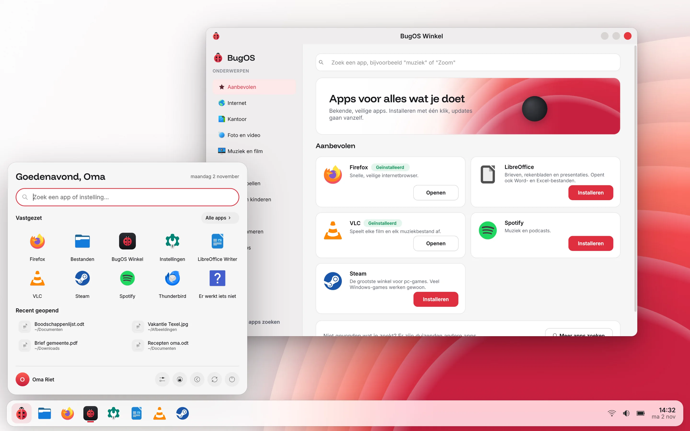
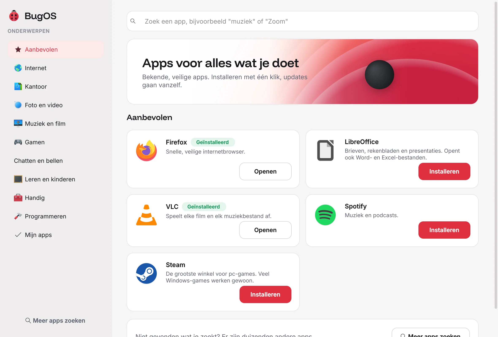
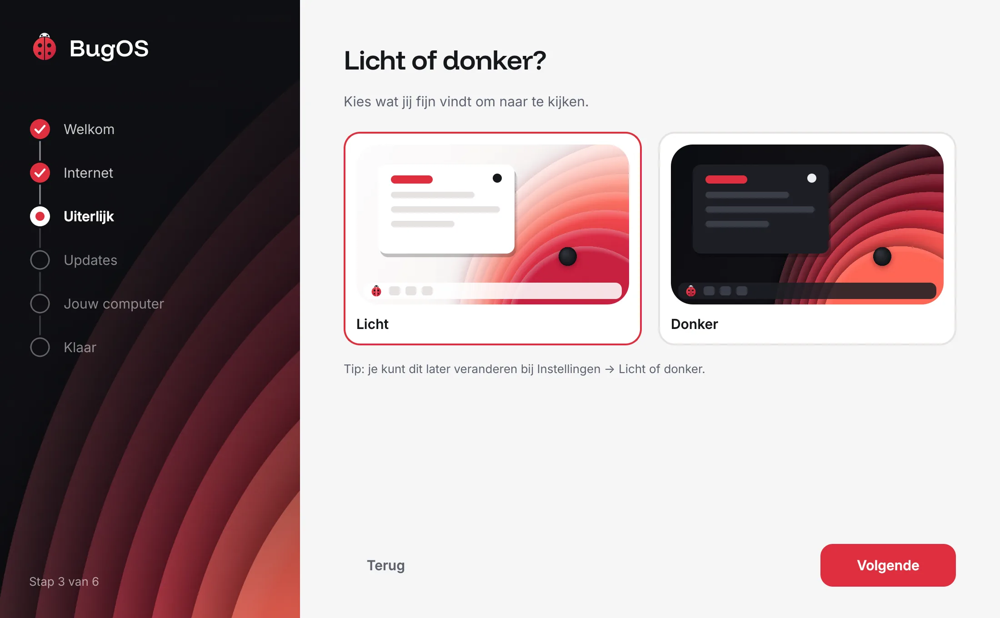
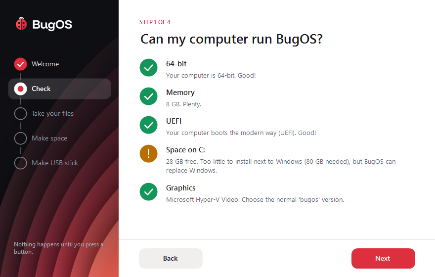

<p align="center">
  <picture>
    <source media="(prefers-color-scheme: dark)" srcset="branding/logo/bugos-logo-wit.svg">
    
  </picture>
</p>

<h3 align="center">De computer die gewoon werkt.</h3>
<p align="center">Gratis, kan niet stuk en fijn voor oma, gamers en programmeurs.</p>
<p align="center">
  <a href="docs/TESTEN.md">Proberen</a> ·
  <a href="docs/PLAN.md">Het plan</a> ·
  <a href="docs/HUISSTIJL.md">Huisstijl</a> ·
  <a href="docs/VERTALEN.md">Vertalen</a>
</p>

<p align="center">
  <picture>
    <source media="(prefers-color-scheme: dark)" srcset="website/assets/bureaublad-donker.webp">
    
  </picture>
</p>

## Wat is BugOS?

BugOS is een gratis besturingssysteem. Je gebruikt het net als Windows, maar het **kan niet stuk**.
Gaat er na een update iets mis? Dan kies je bij het opstarten de versie van gisteren, en alles is weer zoals het was.

| | |
|---|---|
| **Gewoon makkelijk** | Wifi, bluetooth, geluid en printers werken meteen. Grote knoppen en gewone woorden. |
| **Apps met één klik** | De BugOS Winkel heeft bekende, veilige apps. Downloads van een website werken ook. |
| **Windows-programma's** | Dubbelklik op een `.exe` en hij start. Is er een betere versie voor BugOS? Dan stelt BugOS die voor. |
| **Gamen** | Steam, game-modus, controllers en Nvidia zitten er al in. |
| **Programmeren** | Eén schakelaar zet VS Code, containers en programmeertalen klaar. |
| **Updates vanzelf** | Stil op de achtergrond, en pas actief als je opnieuw opstart. Liever zelf kiezen? Dat kan ook. |
| **Ook oude computers** | Heeft je computer weinig geheugen? Dan zet BugOS vanzelf de lichte stand aan. |
| **Van jou** | Geen account nodig, geen reclame, en BugOS verzamelt niks over jou. |

## Zo ziet het eruit

<table>
  <tr>
    <td width="50%">
      <picture>
        <source media="(prefers-color-scheme: dark)" srcset="website/assets/winkel-donker.webp">
        
      </picture>
      <p align="center"><b>BugOS Winkel</b>: apps met één klik</p>
    </td>
    <td width="50%">
      <picture>
        <source media="(prefers-color-scheme: dark)" srcset="website/assets/hulp-donker.webp">
        
      </picture>
      <p align="center"><b>Er werkt iets niet</b>: BugOS kijkt het na en repareert</p>
    </td>
  </tr>
  <tr>
    <td width="50%">
      <picture>
        <source media="(prefers-color-scheme: dark)" srcset="website/assets/instellingen-donker.webp">
        
      </picture>
      <p align="center"><b>Instellingen</b>: grote tegels en een zoekbalk</p>
    </td>
    <td width="50%">
      <picture>
        <source media="(prefers-color-scheme: dark)" srcset="website/assets/welkom-donker.webp">
        
      </picture>
      <p align="center"><b>Welkom</b>: alles stap voor stap ingesteld</p>
    </td>
  </tr>
</table>

## Proberen

BugOS is nog in ontwikkeling (versie 0.3). Probeer het eerst op een reserve-computer of in een virtuele pc.
In [docs/TESTEN.md](docs/TESTEN.md) staat precies hoe.

Nu nog op Windows? Het programmaatje **BugOS Overstap** (in [`windows-overstap/`](windows-overstap/))
kijkt of je computer BugOS aankan, neemt je bestanden mee en maakt de USB-stick voor je.

<p align="center">
  
</p>

## Hoe is de repo ingedeeld?

```
Containerfile          het bouwrecept
build_files/           het bouwscript en de lijst met extra programma's
system_files/          alles wat in BugOS komt (apps, stijl, logo, lettertypes)
iso_live/              de "probeer eerst"-USB-stick
disk_config/           instellingen voor de klassieke USB-stick (ISO)
windows-overstap/      het Windows-programma om over te stappen
website/               de BugOS-website
branding/              logo's, kleuren en lettertypes (zie docs/HUISSTIJL.md)
tools/                 hulpjes voor de makers (logo, achtergrond, vertalingen)
.github/workflows/     de "bakkerij" die BugOS automatisch bouwt
docs/                  uitleg, plan en huisstijl
```

## Licentie

GPL-3.0. BugOS is en blijft gratis en open.
De lettertypes vallen onder de SIL Open Font License (zie [`branding/lettertypes/`](branding/lettertypes/)).

BugOS is gebouwd op [Aurora](https://getaurora.dev) en [Universal Blue](https://universal-blue.org),
[Fedora](https://fedoraproject.org) en [KDE](https://kde.org).
