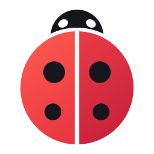

<p align="center">
  
</p>

<h1 align="center">BugOS</h1>
<p align="center"><b>Linux zo makkelijk als Windows. Voor oma, gamers en programmeurs.</b></p>

---

## Wat is het?

BugOS is een gratis besturingssysteem. Je gebruikt het net als Windows, maar het **kan niet stuk**.
Gaat er na een update iets mis? Dan kies je bij het opstarten de vorige versie, en alles is weer zoals gisteren.

- 📶 Wifi, bluetooth, geluid en printers werken gewoon
- 🛒 Programma's haal je in de **BugOS Winkel**, of je dubbelklikt op een download
- 🪟 Windows-programma's (`.exe`) openen met dubbelklik
- 🎮 Steam, game-modus, controllers en Nvidia zitten er al in
- 🛠️ Ontwikkelaarsmodus met één klik: VS Code, containers en programmeertalen
- 🔄 Updates gaan vanzelf (of zelf, als je dat wilt)
- 🐢 Lichte stand voor oude computers
- 🔒 Geen account nodig, en BugOS verzamelt niks over jou

## Meer lezen

- 📐 [De bouwtekening (het plan)](docs/PLAN.md)
- 🧪 [BugOS proberen](docs/TESTEN.md)

## Hoe is de repo ingedeeld?

```
Containerfile          het bouwrecept
build_files/           het bouwscript en de lijst met extra programma's
system_files/          alles wat in BugOS komt (scripts, stijl, logo)
disk_config/           instellingen voor de USB-stick (ISO)
.github/workflows/     de "bakkerij" die BugOS automatisch bouwt
docs/                  uitleg en plan
```

## Licentie

GPL-3.0. BugOS is en blijft gratis en open. BugOS is gebouwd op [Aurora](https://getaurora.dev) en [Universal Blue](https://universal-blue.org), [Fedora](https://fedoraproject.org) en [KDE](https://kde.org).
