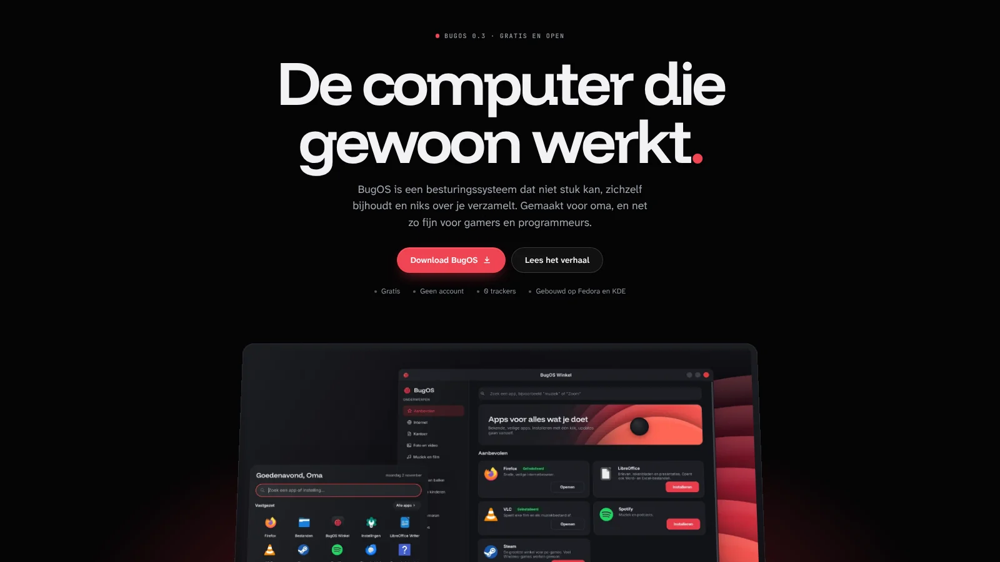
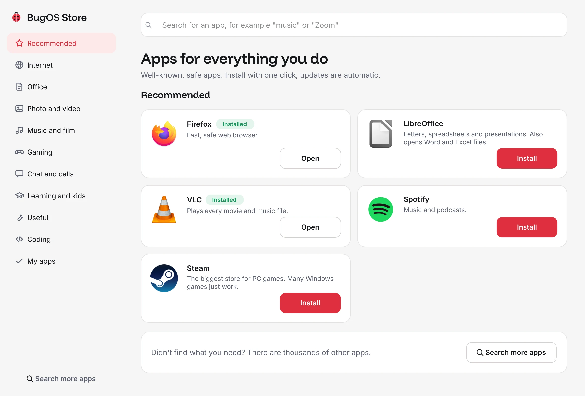
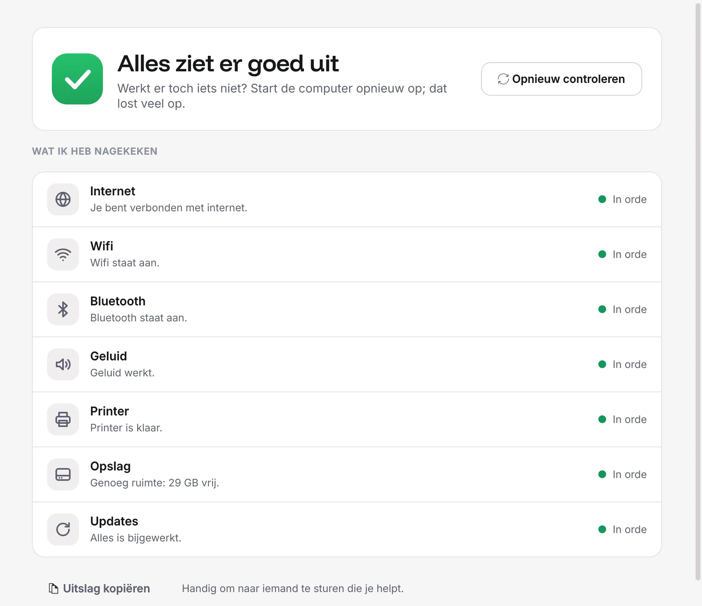
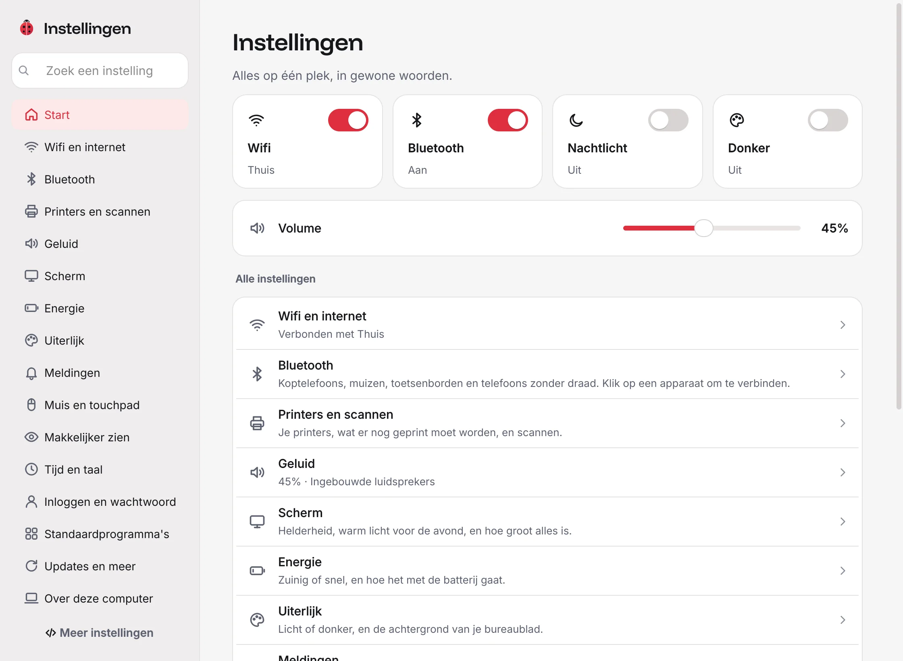
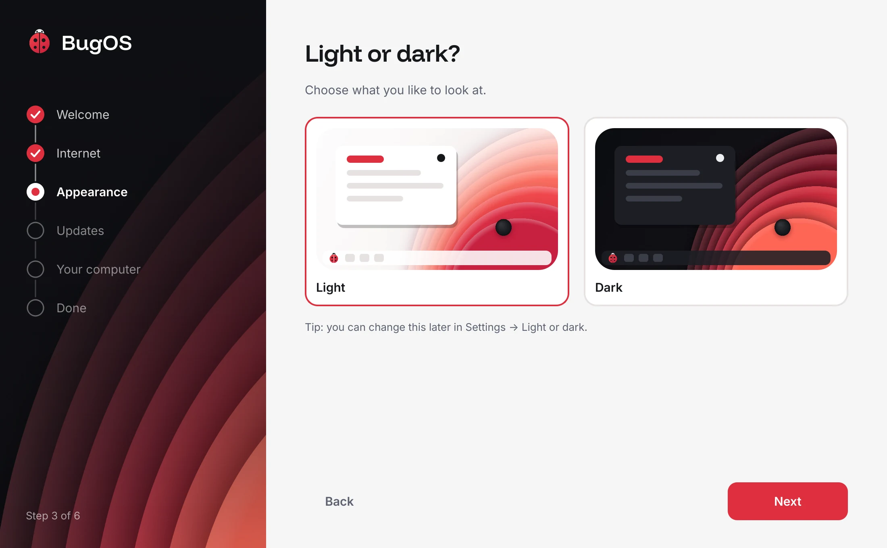
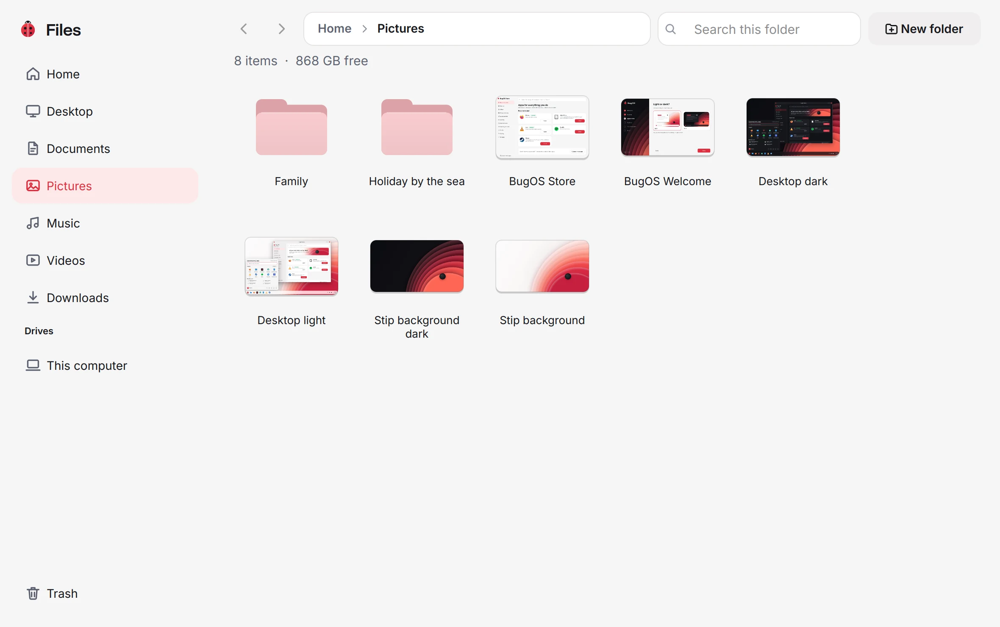
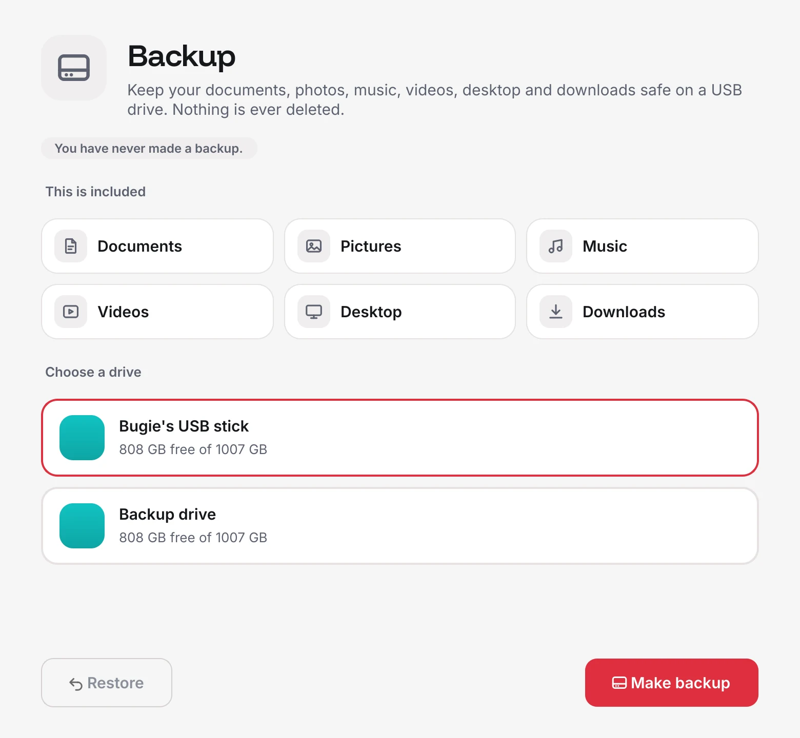
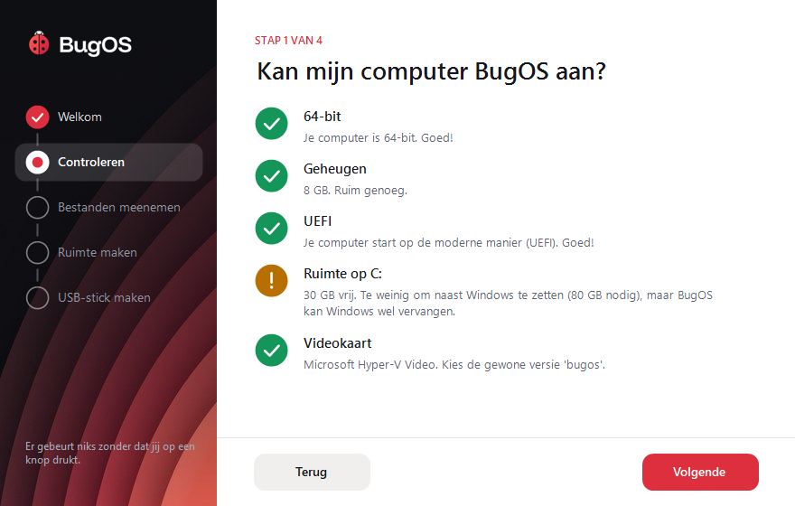

<p align="center">
  <picture>
    <source media="(prefers-color-scheme: dark)" srcset="branding/logo/bugos-logo-white.svg">
    
  </picture>
</p>

<p align="center">
  
</p>

<p align="center">
  <a href="docs/TESTING.md">Try it</a> ·
  <a href="docs/PLAN.md">The plan</a> ·
  <a href="docs/BRAND.md">Brand style</a> ·
  <a href="docs/TRANSLATING.md">Translate</a>
</p>

## The story

A *bug* is a little mistake in a computer. A ladybug eats the little bugs that ruin your plants,
and people say it brings good luck. That is why it is our logo: **BugOS cleans up the bugs**,
so you can simply do what you sat down at the computer for.

> **The Bugie test:** if Bugie can't use it without help, we make it again.

## What is BugOS?

BugOS is a free operating system. You use it just like Windows, but it **can't break**.
Did something go wrong after an update? Then you go back to yesterday's version in Settings, and everything is back the way it was. (Does it not start properly? Hold Shift or press Esc while it starts and pick the previous version for that start; then go back for good in Settings.)

| | |
|---|---|
| **Just easy** | Wi-Fi, Bluetooth, sound and printers work right away. Big buttons and everyday words. |
| **Apps in one click** | The BugOS Store has well-known, safe apps. Downloads from a website work too. |
| **Windows programs** | Double-click an `.exe` and it starts. Is there a better version for BugOS? Then BugOS suggests it. |
| **Gaming** | Steam, game mode and controller support are built in, and there is a version with the Nvidia driver. |
| **Programming** | One switch sets up VS Code, containers and programming languages. |
| **Updates by themselves** | Quietly in the background, and only active when you restart. Rather choose yourself? You can do that too. |
| **Old computers too** | Does your computer have little memory? Then BugOS turns on light mode by itself. |
| **Yours** | No account needed, no ads, and BugOS collects nothing about you. |

## What it looks like

<table>
  <tr>
    <td width="50%">
      <picture>
        <source media="(prefers-color-scheme: dark)" srcset="website/assets/store-dark.webp">
        
      </picture>
      <p align="center"><b>BugOS Store</b>: apps in one click</p>
    </td>
    <td width="50%">
      <picture>
        <source media="(prefers-color-scheme: dark)" srcset="website/assets/help-dark.webp">
        
      </picture>
      <p align="center"><b>Something is not working</b>: BugOS checks it and fixes it</p>
    </td>
  </tr>
  <tr>
    <td width="50%">
      <picture>
        <source media="(prefers-color-scheme: dark)" srcset="website/assets/settings-dark.webp">
        
      </picture>
      <p align="center"><b>Settings</b>: Wi-Fi, sound, printers, signing in and more, in everyday words</p>
    </td>
    <td width="50%">
      <picture>
        <source media="(prefers-color-scheme: dark)" srcset="website/assets/welcome-dark.webp">
        
      </picture>
      <p align="center"><b>Welcome</b>: everything set up step by step</p>
    </td>
  </tr>
  <tr>
    <td width="50%">
      <picture>
        <source media="(prefers-color-scheme: dark)" srcset="website/assets/explorer-dark.webp">
        
      </picture>
      <p align="center"><b>Files</b>: your photos and documents, just like in Windows</p>
    </td>
    <td width="50%">
      <picture>
        <source media="(prefers-color-scheme: dark)" srcset="website/assets/backup-dark.webp">
        
      </picture>
      <p align="center"><b>Backup</b>: one button, straight to a USB drive</p>
    </td>
  </tr>
</table>

## Try it

BugOS is still being built (version 0.3). Try it first on a spare computer or in a virtual PC.
[docs/TESTING.md](docs/TESTING.md) explains exactly how.

Still on Windows? The little program **BugOS Switch** (in [`windows-switch/`](windows-switch/))
checks whether your computer can run BugOS, takes your files along and makes the USB stick for you.

<p align="center">
  
</p>

## How is the repo organized?

```
Containerfile          the build recipe
build_files/           the build script and the list of extra programs
system_files/          everything that goes into BugOS (apps, style, logo, fonts)
iso_live/              the "try it first" USB stick
disk_config/           settings for the classic USB stick (ISO)
windows-switch/      the Windows program for switching over
website/               the BugOS website
branding/              logos, colors and fonts (see docs/BRAND.md)
tools/                 little helpers for the makers (logo, background, translations)
.github/workflows/     the "bakery" that builds BugOS automatically
docs/                  explanations, plan and brand style
```

## License

GPL-3.0. BugOS is and stays free and open.
The fonts are under the SIL Open Font License (see [`branding/fonts/`](branding/fonts/)).

BugOS is its own system, built on `kinoite-main` from [Universal Blue](https://universal-blue.org) (just like Bazzite),
[Fedora](https://fedoraproject.org) Kinoite and [KDE](https://kde.org).
