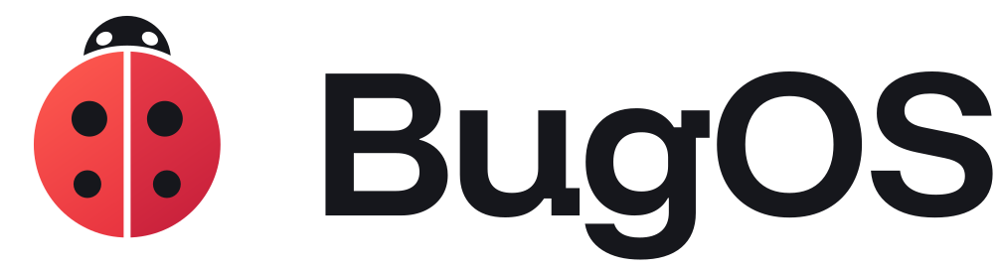
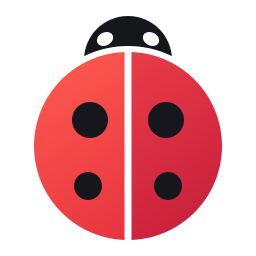
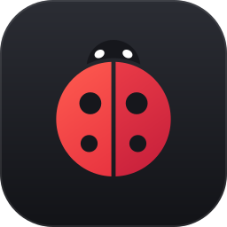
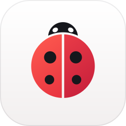
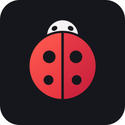
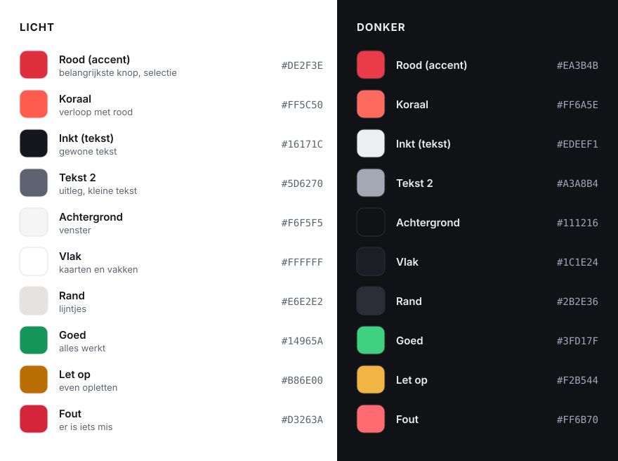
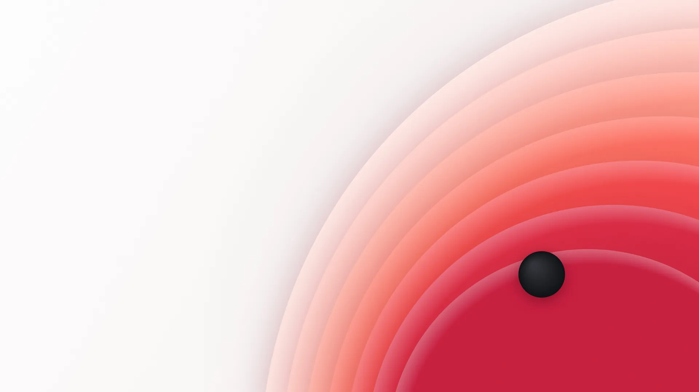
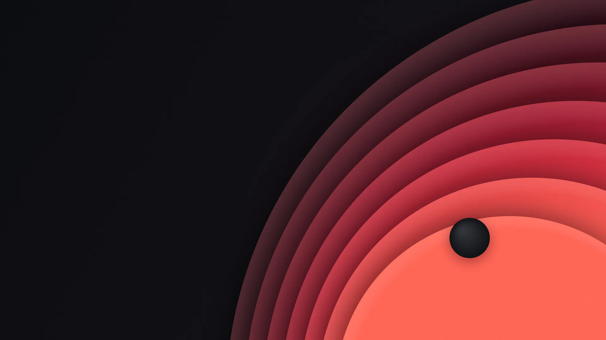

<p align="center">
  <picture>
    <source media="(prefers-color-scheme: dark)" srcset="../branding/logo/bugos-logo-white.svg">
    
  </picture>
</p>

# The BugOS style guide

> This is how BugOS looks, and why. For everyone who makes something for BugOS:
> an app, a picture, the website or a presentation.

## In short

1. **Calm and clear.** Lots of space, big buttons, everyday words.
2. **One red button per screen.** Red is for the most important thing: the button you should press.
3. **Always light and dark.** Everything we make works in both.
4. **Talk the way you would talk to Bugie.** Short sentences, say "you", no difficult words.
5. **The dot.** Our little signature: a red dot after the most important sentence,
   like the spot on a ladybug. Use it sparingly: once per page is enough.

### The Bugie test

> Bugie doesn't get it? Then we make it again.

This is our most important rule. Every button, every word and every screen has to pass it.
If Bugie gets it, everyone gets it.

## The logo

<p>
  
  &nbsp;&nbsp;
  
  &nbsp;&nbsp;
  
  &nbsp;&nbsp;
  
</p>

Our logo is a **ladybug**, made of simple shapes:
two red wings with a narrow gap between them, a black head with two white spots
(just like a real ladybug) and two black dots on each wing.

**Why a ladybug?** In computer language, a *bug* is a little mistake.
A ladybug is the friendliest bug there is, and it eats the real
bugs. BugOS is the same: it cleans up the problems for you.
And people say a ladybug brings good luck.

**Every part means something:**

| Part | Meaning |
|---|---|
| Two wings | Today and yesterday. BugOS always keeps the previous version. If something goes wrong, you fly on the other one. |
| Four dots | Four promises: it can't break, it's easy, it's yours and it's free. |
| A friendly head | Two white spots, just like a real ladybug. BugOS is never scary. |

The whole bug is drawn with round shapes and one straight line: the gap between the wings.

### Which file do I use?

All files are in [`branding/logo/`](../branding/logo/) (and as PNG in [`branding/png/`](../branding/png/)).

| File | When |
|---|---|
| `bugos-logo.svg` | The bug with the word BugOS, on a light background. **This is the normal logo.** |
| `bugos-logo-white.svg` | The same, on a dark background or a photo. The head is light, so it doesn't disappear. |
| `bugos-mark.svg` | Just the bug, in color. When there is little space. |
| `bugos-mark-dark.svg` | Just the bug, on a dark background (light head with dark eyes). |
| `bugos-mark-system.svg` | Inside BugOS itself: the head changes color along with light and dark. |
| `bugos-mark-ink.svg`, `-wit`, `-rood` | In one color, for example for a stamp, sticker or laser. |
| `bugos-icon.svg` | App icon: the bug on a dark, rounded tile. |
| `bugos-icon-light.svg` | App icon on a light tile. |
| `bugos-wordmark.svg`, `-wit` | Just the word BugOS. |

### Rules for the logo

- **Space around it:** keep at least the width of the bug's head free on all sides.
- **On dark:** always use a dark variant (`-donker` or `-wit`). The normal bug has a black head, and that disappears on a dark background.
- **Not too small:** the bug at least 16 pixels, the logo with the word at least 96 pixels wide.
- **Don't:** stretch or squash it, rotate it, give it other colors, put a shadow or border around it,
  or set the word BugOS in a different font.

## Colors



- **Red is used sparingly.** Use it for the most important button, something that is selected, and the logo. Not for large areas of text.
- **Gray is a little warm.** Our grays have a tiny bit of red in them. Never pure gray.
- **Good, warning and error** are only for messages (green, orange and red), always together with a symbol (✓, !, ✕) and text. Color alone is not enough: not everyone sees colors well.
- **The logo** uses a gradient from coral to red: `#FF5C50` → `#E52F3E` (left wing) and `#EE3F49` → `#C41D3A` (right wing), with ink `#16171C`.

The colors are also in the code: [`bugos_ui.py`](../system_files/usr/lib/bugos/python/bugos_ui.py) (apps),
[`BugOSLight.colors`](../system_files/usr/share/color-schemes/BugOSLight.colors) and
[`BugOSDark.colors`](../system_files/usr/share/color-schemes/BugOSDark.colors) (desktop).

## Fonts

| Font | What for |
|---|---|
| **Funnel Display** | Headings and the word BugOS. Round and friendly, with character. |
| **Inter** | All text in BugOS itself: menus, buttons and apps. |
| **Atkinson Hyperlegible Next** | Body text on the website. Made especially to be extra easy to read, also for people with poor eyesight. |
| **JetBrains Mono** | Code and the terminal. |
| Segoe UI | Only in BugOS Overstap on Windows (there it belongs to Windows itself). |

All fonts are free and open (license: SIL Open Font License).
They are in [`branding/fonts/`](../branding/fonts/) and are also included in BugOS itself.
The website uses its own copies and loads **nothing** from Google: that keeps your visit private.

## The wallpaper: "Stip"

<p>
  
  
</p>

Round layers that run from light to deep red, with one black dot ("stip" is Dutch for dot), like the spot on a
ladybug. There is a light and a dark version; BugOS picks the right one by itself.
The wallpaper also comes back in the welcome screen, the boot screen, the login screen,
BugOS Overstap and on the website.

To make it again (in 3840 × 2160 and 3840 × 2400):

```bash
node tools/wallpaper/make.js achtergronden
```

## Shapes

- **Round, but not too round.** Buttons 12 pixels, cards 16, large areas 22 to 28.
  On the website the buttons are fully round.
- **Spacing:** we use steps of 4: 4, 8, 12, 16, 24, 32, 48.
- **Icons:** our own **BugOS line icons**: 24 × 24, line width 2, round ends. The same set
  is in the apps (`LIJN` in [`bugos_ui.py`](../system_files/usr/lib/bugos/python/bugos_ui.py), used
  as `lijn:naam`) and on the website. The same everywhere: a line icon on a calm gray tile. We no longer use colored tiles; only real app logos (Firefox, Spotify) keep their own color.
- **Only what needs attention gets color.** If everything is fine, it stays calm gray with a
  small green dot. A problem turns orange or red, with a button that fixes it.
- **No emoji** in apps and on the website. Real icons are fine.

## How we talk

English is the default language of BugOS; Dutch is a built-in translation. The same rules apply to both.

| Not like this | Like this |
|---|---|
| An error has occurred (code 0x80070005). | That didn't work, because you don't have permission. Press "Try again" and choose "Yes" when Windows asks. |
| Rollback to previous deployment | Back to yesterday's version |
| Container | Box |
| Install Flatpak | Install |
| OK | Say what happens: "Copy files", "Make USB stick" |
| Formal and distant ("U" in Dutch) | Talk directly to "you" ("je, jij" in Dutch) |

- **Short sentences.** One thing per sentence.
- **Say what happens** and what someone can do. Never blame anyone.
- **Ask first** when something could be lost, and say exactly what: "Everything on the USB stick will be erased."
- **Need a difficult word?** Explain it right away, in brackets or in a second sentence.

## Making the files again

| What | How |
|---|---|
| All logos (SVG) | `python3 tools/brand/make.py` (needs `uharfbuzz` and `fonttools`) |
| Logo as PNG | `node tools/brand/png.js branding/logo/bugos-icon.svg branding/png/bugos-icon-512.png 512` |
| Wallpaper "Stip" | `node tools/wallpaper/make.js <map>` |
| Color chart above | `branding/colors.svg` (just an SVG; change the codes when the colors change) |
| Website | Edit `tools/website/page.html` and run `python3 tools/website/build.py`. It puts the real logo and the construction drawing into `website/index.html`. |

The PNG and wallpaper helpers use Chromium through [Playwright](https://playwright.dev).

## The app shell

All BugOS apps (Files, Settings, Task Manager, Store) sit in the same shell, from `bugos_ui`:

- **On the left** a 248 px sidebar with the **name of the app** (and the small bug in front of it), the sections,
  and at the bottom a quiet button for advanced users ("More settings", "System monitor").
- **On the right** pages with a big title, one sentence of explanation, and cards. The content is never wider than
  880 px: that reads calmly, even on a big screen.
- **Rows** (`Rij`): icon, name, one line of explanation, and on the right a switch, a button or an arrow.
  A row should preferably be clickable itself (click the network to connect); separate buttons only where they are
  really needed, the rest behind "…".
- **Choosing** happens with a floating bar at the bottom (`ActieBalk`): "Firefox · Close · Force close".
- **Headings** above cards are normal sentences ("Networks nearby"), not all capitals.
- **Red** is only an accent: the main button, a switch that is on, the selected section on the left. Meters,
  small charts and selected tiles are gray; folders have a soft BugOS tint.
- **Notifications** (`Melding`) appear at the top of the page and disappear by themselves, with at most one button
  ("Undo").

## The desktop

- **Taskbar** at the bottom, floating and always visible. On the left the ladybug as the start button, then the pinned apps, on the right the quick menu (two switches), the system tray and the clock.
- **Start menu**: a greeting with your first name, one big search bar that finds apps and settings, pinned apps as tiles, recent files, and at the bottom your name with the power buttons. Only "Shut down" turns red when you point at it.
- **Quick menu**: six big tiles (on = red gradient, off = calm flat tile) and a volume slider. A small arrow next to a tile opens the matching page in Settings.
- **Shutdown screen**: dark over the whole screen, one question in plain words ("Shut down the computer?"), big tiles and one red tile. "Never mind" or Esc goes back.

## One system, one look

BugOS should feel like one whole, the way Windows 11 or macOS do. Every window, menu and pop-up uses
the same surfaces, shapes and letters, whether it is a BugOS app, a KDE program, a GTK program (Firefox,
GNOME apps), an app from the Store (Flatpak), the terminal or a Windows program.

- **One source.** Colors (`KLEUREN`) and sizes (`MATEN`) live only in
  [`bugos_ui.py`](../system_files/usr/lib/bugos/python/bugos_ui.py). Everything else is made from it:

  | Part | Made by |
  |---|---|
  | BugOS apps | `bugos_ui` style sheet (directly) |
  | Start menu and quick menu | `Design.qml`, made by `python3 tools/design/make_qml.py` |
  | KDE programs (buttons, fields, lists) | Kvantum themes `BugOS` / `BugOSDark` and the color schemes, by `python3 tools/kvantum/make.py` |
  | Taskbar, tray pop-ups, notifications | Plasma style `bugos`, by `python3 tools/plasma/surfaces.py` and `buttons.py` |
  | Icons | Icon theme `BugOS`, by `python3 tools/icons/make.py` |
  | GTK programs (Firefox, GNOME apps) | A thin layer `bugos.css` on top of Breeze-GTK, by `python3 tools/gtk/make.py` |
  | Store apps (Flatpak) | The same Kvantum and GTK files, read-only; `bugos-flatpak-style` adds the style extensions |
  | Terminal | Konsole profiles and colors `BugOS` / `BugOSDark`, by `python3 tools/konsole/make.py` |
  | Windows programs (Wine) | System colors `light.reg` / `dark.reg`, by `python3 tools/wine/make.py` |

  CI fails when a made file is out of date. Never change a made file by hand.
- **One surface per window.** The title bar, the toolbars, the sidebar and the page all have the window color
  (`achter`). Content sits on white cards (`vlak`) with a hairline (`rand`). No separator lines between the title
  bar and the window, and no differently colored sidebar.
- **Pop-ups are small windows.** Tray pop-ups, the start menu and the quick menu have the window color with white
  tiles and cards inside, 22 px corners and the same soft shadow.
- **One size scale.** Controls (buttons, fields, list rows, menus, tooltips) 12 px corners, cards and tiles 16,
  pop-ups and panels 22. Round buttons with only an icon are circles. Sliders: track 8 px with a coral-to-red fill,
  a white knob of 22 px.
- **One set of letters.** Inter for everything (14 px text, 13 px small, 15 px row names), Funnel Display only for
  titles (pop-up title 20 px, page title 30 px). The window title uses Inter semibold.
- **One way to point and choose.** Pointing at something gives a calm gray (`knop`); the chosen item is soft red
  with red text (`accent_zacht`); keyboard focus is a 2 px red ring.
- **Dress, don't repaint.** Programs that are not ours keep their own layout. BugOS only gives them its colors,
  corners, sliders, switches and red accent, through the route the program itself reads (the color scheme, a
  GTK layer, the terminal profile, Wine's system colors). We never patch one program at a time, and what
  someone chooses themselves (another theme, another terminal profile, removing the GTK layer) stays.
- **Where we stop.** The login and lock screen, the boot screen and the boot menu already follow BugOS through
  the Plasma style, the wallpaper, the BugOS logo and the name BugOS. Programs that draw everything themselves
  (Steam, games, Electron apps such as Discord) keep their own look. The mouse pointer and the system sounds stay
  Breeze and Ocean: calm and familiar, and they do not need to say BugOS.
