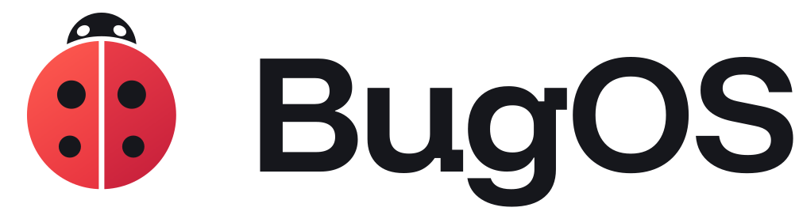
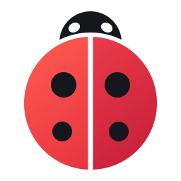
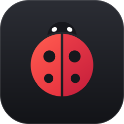
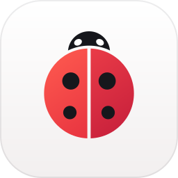
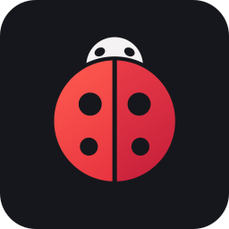
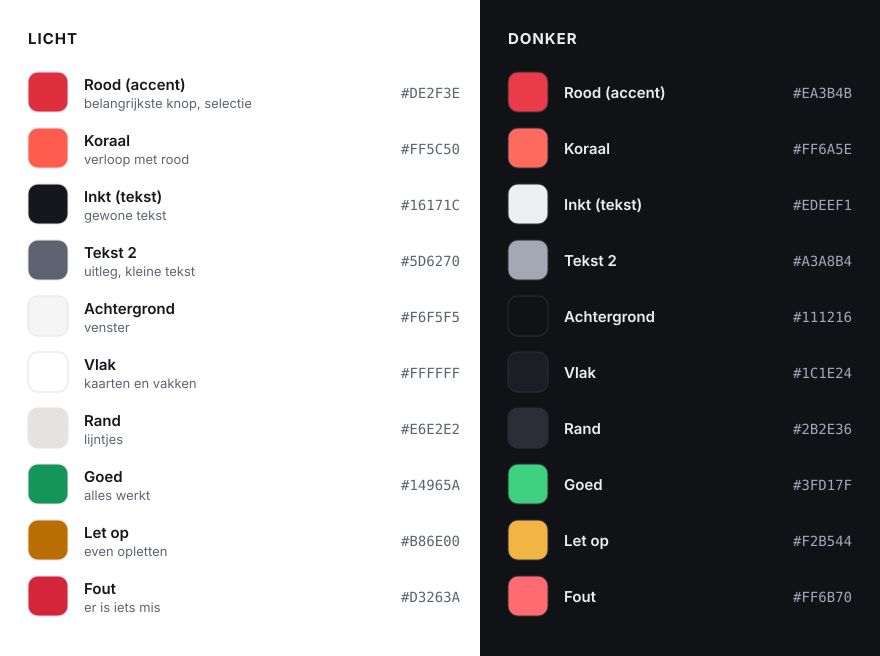
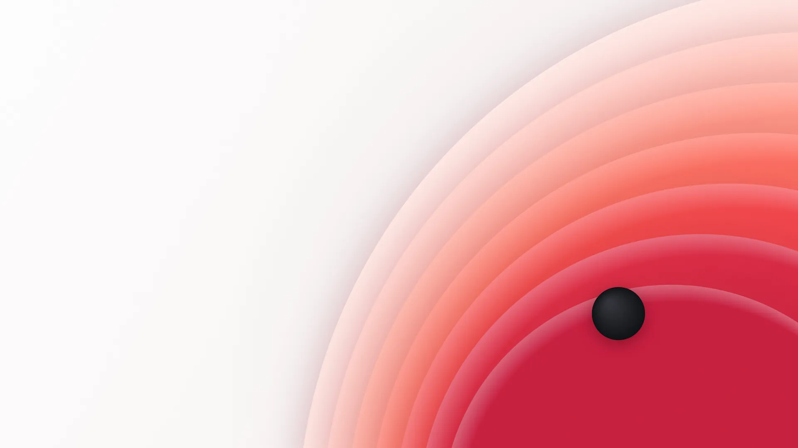
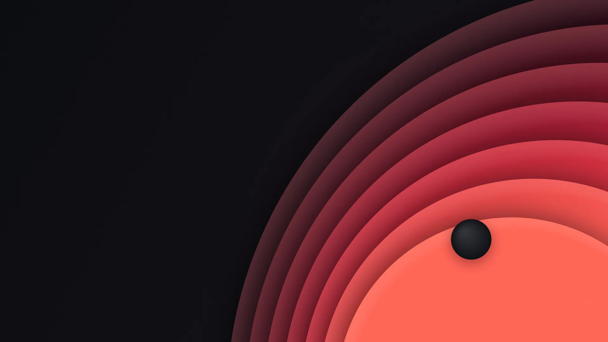

<p align="center">
  <picture>
    <source media="(prefers-color-scheme: dark)" srcset="../branding/logo/bugos-logo-wit.svg">
    
  </picture>
</p>

# De BugOS-huisstijl

> Zo ziet BugOS eruit, en waarom. Voor iedereen die iets voor BugOS maakt:
> een app, een plaatje, de website of een presentatie.

## In het kort

1. **Rustig en duidelijk.** Veel ruimte, grote knoppen, gewone woorden.
2. **Eén rode knop per scherm.** Rood is voor het belangrijkste: daar moet je op drukken.
3. **Altijd licht én donker.** Alles wat we maken, werkt in allebei.
4. **Praat zoals tegen oma.** Korte zinnen, "je" en "jij", geen moeilijke woorden.
5. **De stip.** Ons handtekeningetje: een rode punt achter de belangrijkste zin,
   zoals de stip op een lieveheersbeestje. Spaarzaam gebruiken: één keer per pagina is genoeg.

### De oma-test

> Snapt oma het niet? Dan maken we het opnieuw.

Dit is onze belangrijkste regel. Elke knop, elk woord en elk scherm moet erdoor.
Wat oma snapt, snapt iedereen.

## Het logo

<p>
  
  &nbsp;&nbsp;
  
  &nbsp;&nbsp;
  
  &nbsp;&nbsp;
  
</p>

Ons logo is een **lieveheersbeestje**, gemaakt van simpele vormen:
twee rode vleugels met een smalle spleet ertussen, een zwarte kop met twee witte vlekjes
(net als bij een echt lieveheersbeestje) en twee zwarte stippen op elke vleugel.

**Waarom een lieveheersbeestje?** In computertaal is een *bug* een foutje.
Een lieveheersbeestje is het vriendelijkste beestje dat er is, en het eet de echte
beestjes op. Zo is BugOS ook: het ruimt de problemen voor je op.
En volgens oma brengt een lieveheersbeestje geluk.

**Elk onderdeel betekent iets:**

| Onderdeel | Betekenis |
|---|---|
| Twee vleugels | Vandaag en gisteren. BugOS bewaart altijd de vorige versie. Gaat er iets mis, dan vlieg je op de andere. |
| Vier stippen | Vier beloftes: het kan niet stuk, het is makkelijk, het is van jou en het is gratis. |
| Een vriendelijke kop | Twee witte vlekjes, net als een echt lieveheersbeestje. BugOS is nooit eng. |

Het hele beestje is getekend met ronde vormen en één rechte lijn: de spleet tussen de vleugels.

### Welk bestand gebruik ik?

Alle bestanden staan in [`branding/logo/`](../branding/logo/) (en als PNG in [`branding/png/`](../branding/png/)).

| Bestand | Wanneer |
|---|---|
| `bugos-logo.svg` | Beestje met het woord BugOS, op een lichte achtergrond. **Dit is het gewone logo.** |
| `bugos-logo-wit.svg` | Hetzelfde, op een donkere achtergrond of een foto. Het kopje is dan licht, zodat het niet verdwijnt. |
| `bugos-merk.svg` | Alleen het beestje, in kleur. Als er weinig ruimte is. |
| `bugos-merk-donker.svg` | Alleen het beestje, op een donkere achtergrond (licht kopje met donkere oogjes). |
| `bugos-merk-systeem.svg` | Binnen BugOS zelf: het kopje kleurt mee met licht en donker. |
| `bugos-merk-inkt.svg`, `-wit`, `-rood` | In één kleur, bijvoorbeeld voor een stempel, sticker of laser. |
| `bugos-icoon.svg` | App-icoon: het beestje op een donkere, ronde tegel. |
| `bugos-icoon-licht.svg` | App-icoon op een lichte tegel. |
| `bugos-woordmerk.svg`, `-wit` | Alleen het woord BugOS. |

### Regels voor het logo

- **Ruimte eromheen:** houd rondom minstens de breedte van de kop van het beestje vrij.
- **Op donker:** gebruik altijd een variant voor donker (`-donker` of `-wit`). Het gewone beestje heeft een zwart kopje, en dat verdwijnt op een donkere achtergrond.
- **Niet te klein:** het beestje minstens 16 beeldpunten, het logo met woord minstens 96 beeldpunten breed.
- **Niet doen:** uitrekken of platdrukken, draaien, andere kleuren geven, een schaduw of rand eromheen,
  of het woord BugOS in een ander lettertype zetten.

## Kleuren



- **Rood is spaarzaam.** Gebruik het voor de belangrijkste knop, iets wat gekozen is, en het logo. Niet voor grote vlakken tekst.
- **Grijs is een beetje warm.** Onze grijzen hebben een heel klein beetje rood erin. Nooit puur grijs.
- **Goed, let op en fout** zijn alleen voor meldingen (groen, oranje en rood), altijd samen met een teken (✓, !, ✕) en tekst. Kleur alleen is niet genoeg: niet iedereen ziet kleuren goed.
- **Het logo** gebruikt een verloop van koraal naar rood: `#FF5C50` → `#E52F3E` (linkervleugel) en `#EE3F49` → `#C41D3A` (rechtervleugel), met inkt `#16171C`.

De kleuren staan ook in de code: [`bugos_ui.py`](../system_files/usr/lib/bugos/python/bugos_ui.py) (apps),
[`BugOSLicht.colors`](../system_files/usr/share/color-schemes/BugOSLicht.colors) en
[`BugOSDonker.colors`](../system_files/usr/share/color-schemes/BugOSDonker.colors) (bureaublad).

## Letters

| Lettertype | Waarvoor |
|---|---|
| **Funnel Display** | Koppen en het woord BugOS. Rond en vriendelijk, met karakter. |
| **Inter** | Alle tekst in BugOS zelf: menu's, knoppen en apps. |
| **Atkinson Hyperlegible Next** | Lopende tekst op de website. Speciaal gemaakt om extra goed leesbaar te zijn, ook voor mensen die slecht zien. |
| **JetBrains Mono** | Code en de terminal. |
| Segoe UI | Alleen in BugOS Overstap op Windows (daar hoort het bij Windows zelf). |

Alle lettertypes zijn gratis en open (licentie: SIL Open Font License).
Ze staan in [`branding/lettertypes/`](../branding/lettertypes/) en zitten ook in BugOS zelf.
De website gebruikt eigen kopieën en haalt **niets** bij Google: zo blijft je bezoek privé.

## De achtergrond: "Stip"

<p>
  
  
</p>

Ronde lagen die van licht naar diep rood lopen, met één zwarte stip, zoals de stip op een
lieveheersbeestje. Er is een lichte en een donkere versie; BugOS kiest vanzelf de goede.
De achtergrond komt ook terug in het welkomstscherm, het opstartscherm, het inlogscherm,
BugOS Overstap en op de website.

Opnieuw maken (in 3840 × 2160 en 3840 × 2400):

```bash
node tools/achtergrond/maak.js achtergronden
```

## Vormen

- **Rond, maar niet te rond.** Knoppen 12 beeldpunten, kaarten 16, grote vlakken 22 tot 28.
  Op de website zijn de knoppen helemaal rond.
- **Ruimte:** we gebruiken stapjes van 4: 4, 8, 12, 16, 24, 32, 48.
- **Icoontjes:** onze eigen **BugOS-lijniconen**: 24 × 24, lijn van 2, ronde uiteinden. Dezelfde set
  zit in de apps (`LIJN` in [`bugos_ui.py`](../system_files/usr/lib/bugos/python/bugos_ui.py), te gebruiken
  als `lijn:naam`) en op de website. Overal hetzelfde: een lijnicoon op een rustig grijs tegeltje. Gekleurde tegeltjes gebruiken we niet meer; alleen echte app-logo's (Firefox, Spotify) houden hun eigen kleur.
- **Alleen wat aandacht nodig heeft, krijgt kleur.** Gaat alles goed, dan blijft het rustig grijs met een
  klein groen bolletje. Een probleem wordt oranje of rood, met een knop die het oplost.
- **Geen emoji** in apps en op de website. Wel echte iconen.

## Zo praten we

| Niet zo | Wel zo |
|---|---|
| Er is een fout opgetreden (code 0x80070005). | Dat lukte niet, want je hebt geen toestemming. Druk op "Opnieuw" en kies "Ja" als Windows het vraagt. |
| Rollback naar vorige deployment | Terug naar de versie van gisteren |
| Container | Doosje |
| Flatpak installeren | Installeren |
| OK | Zeg wat er gebeurt: "Bestanden kopiëren", "USB-stick maken" |
| U | Je, jij |

- **Korte zinnen.** Eén ding per zin.
- **Zeg wat er gebeurt** en wat iemand kan doen. Nooit iemand de schuld geven.
- **Vraag het eerst** als er iets weg kan gaan, en zeg dan precies wat: "Alles op de USB-stick wordt gewist."
- **Moeilijk woord nodig?** Leg het meteen uit, tussen haakjes of in een tweede zin.

## Bestanden opnieuw maken

| Wat | Hoe |
|---|---|
| Alle logo's (SVG) | `python3 tools/merk/maak.py` (heeft `uharfbuzz` en `fonttools` nodig) |
| Logo als PNG | `node tools/merk/png.js branding/logo/bugos-icoon.svg branding/png/bugos-icoon-512.png 512` |
| Achtergrond "Stip" | `node tools/achtergrond/maak.js <map>` |
| Kleurenkaart hierboven | `branding/kleuren.svg` (gewoon een SVG; pas de codes aan als de kleuren veranderen) |
| Website | Pas `tools/website/pagina.html` aan en draai `python3 tools/website/bouw.py`. Die zet het echte logo en de opbouwtekening in `website/index.html`. |

De PNG- en achtergrond-hulpjes gebruiken Chromium via [Playwright](https://playwright.dev).

## De schil van de apps

Alle BugOS-apps (Bestanden, Instellingen, Taakbeheer, Winkel) zitten in dezelfde schil, uit `bugos_ui`:

- **Links** een zijbalk van 248 px met de **naam van de app** (en het beestje klein ervoor), de onderdelen,
  en onderaan een stille knop voor gevorderden ("Meer instellingen", "Systeemmonitor").
- **Rechts** pagina's met een grote titel, één zin uitleg en kaarten. De inhoud wordt nooit breder dan
  880 px: dat leest rustig, ook op een groot scherm.
- **Regels** (`Rij`): icoontje, naam, een regel uitleg, en rechts een schuifje, een knop of een pijltje.
  Een regel is liefst zelf klikbaar (klik op het netwerk om te verbinden); losse knoppen alleen waar het
  echt nodig is, de rest achter "…".
- **Kiezen** gebeurt met een zwevend balkje onderin (`ActieBalk`): "Firefox · Sluiten · Geforceerd sluiten".
- **Kopjes** boven kaarten zijn gewone zinnen ("Netwerken in de buurt"), geen hoofdletters.
- **Rood** is alleen accent: de hoofdknop, een schuifje dat aanstaat, het gekozen onderdeel links. Meters,
  grafiekjes en gekozen tegels zijn grijs; mappen hebben een zachte BugOS-tint.
- **Meldingen** (`Melding`) staan bovenin de pagina en verdwijnen vanzelf, met eventueel één knop
  ("Ongedaan maken").
