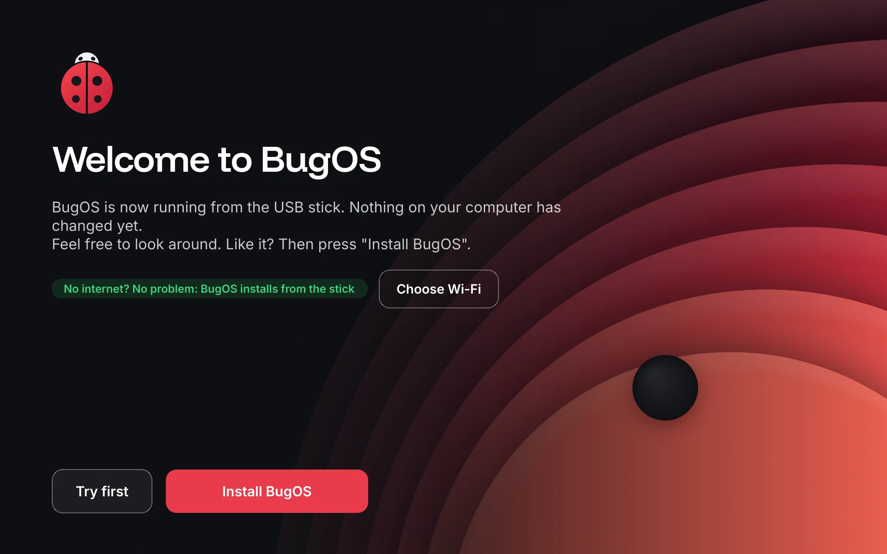

# 🧪 BugOS proberen

## Stap 1: De bakkerij aanzetten (één keer)

1. Ga op GitHub naar deze repo, dan **Actions**. Zet de workflows aan als GitHub daarom vraagt.
2. Elke keer als er iets verandert, bouwt GitHub BugOS opnieuw. Je ziet een groen vinkje ✅ als het gelukt is.
3. Ga naar je GitHub-profiel, dan **Packages**, dan `bugos`, dan **Package settings**. Zet de zichtbaarheid op **Public**. Doe hetzelfde voor `bugos-nvidia`. Dit is nodig, anders kunnen computers de updates niet ophalen.

## Stap 2: Een USB-stick (ISO) maken

1. Ga naar **Actions**, dan **BugOS ISO maken**, dan **Run workflow**.
2. Kies `bugos` (gewone pc) of `bugos-nvidia` (pc met een Nvidia-kaart).
3. Laat "tag" op `latest` staan en "soort" op `live` (de "probeer eerst"-stick).
4. Zet "publiceren" aan als de ISO een echte download moet worden (een GitHub Release). Laat hem uit om alleen te testen.
5. Na ongeveer 30 tot 60 minuten staat de ISO onderaan de pagina (**Artifacts**), of bij **Releases** als je hebt gepubliceerd.
6. Zet hem op een USB-stick met **BugOS Overstap** (Windows), [Fedora Media Writer](https://fedoraproject.org/workstation/download) of [balenaEtcher](https://etcher.balena.io/).

Zo ziet de "probeer eerst"-stick eruit als hij opstart:



## Stap 3: Proberen in een virtuele pc (het veiligst)

Een virtuele pc is een "computer in je computer". Je echte computer blijft dan helemaal zoals hij is.

- **Windows:** gebruik [VirtualBox](https://www.virtualbox.org/). Maak een nieuwe machine, kies de ISO, geef hem 4 GB geheugen en 40 GB schijf, en zet EFI aan.
- **Linux:** gebruik GNOME Boxes of virt-manager.

## Al een Fedora Atomic of Aurora? Dan kan het zonder USB

Typ in de terminal:

```bash
sudo bootc switch ghcr.io/253ugursahin/bugos:latest
```

Herstart daarna de computer. Wil je terug? Kies dan in het opstartmenu de vorige versie.

## Wat moet je testen?

- [ ] Verschijnt BugOS Welkom na de eerste keer inloggen?
- [ ] Werkt licht/donker kiezen?
- [ ] Zit de taakbalk onderaan, met het lieveheersbeestje als startknop?
- [ ] Wifi en bluetooth verbinden
- [ ] Dubbelklik op een `.exe` (bijvoorbeeld Notepad++)
- [ ] Zoek "Game-modus" in het startmenu en zet hem aan en weer uit
- [ ] Draai `bugos-updates status` in de terminal
- [ ] Open **Instellingen** en zoek op "wifi"
- [ ] Open **Er werkt iets niet** en zet het geluid op stil: krijg je een "Repareer"-knop?
- [ ] Open **Back-up** en maak een back-up naar een USB-stick
- [ ] Probeer op een Windows-pc **BugOS Overstap** (stap 1 en 2 zijn veilig, die veranderen niets aan je pc)
- [ ] Open de **BugOS Winkel** en installeer iets
- [ ] Het lieveheersbeestje linksonder is het **BugOS-startmenu**: zoek "wifi" en open de pagina; de Windows-toets opent het menu
- [ ] Het **snelmenu** (twee schuifjes, naast het systeemvak): zet wifi uit en aan; het pijltje bij Wifi opent Instellingen
- [ ] Uitzetten via het startmenu: je ziet het **BugOS-uitzetscherm** met grote tegels; "Toch niet" gaat terug
- [ ] Liever het KDE-menu? Instellingen → Updates en meer → Taakbalk: zet het BugOS-startmenu uit en weer aan
- [ ] Start de "probeer eerst"-stick op: verschijnt het welkomstscherm met "Eerst proberen" en "BugOS installeren"?
- [ ] Is er op de stick nergens "Aurora" of "Fedora" te zien (geen "Welcome Center", één installeer-knop, Nederlandse teksten)?
- [ ] Installeer BugOS **zonder internet** (kabel eruit, wifi uit): lukt het, en start daarna BugOS op?

### Het nieuwe design

- [ ] Zie je het BugOS-beestje tijdens het opstarten (voordat je inlogt)?
- [ ] Heeft het inlogscherm de donkere Stip-achtergrond?
- [ ] Zie je na het inloggen het BugOS-opstartscherm (logo met drie bolletjes)?
- [ ] Is de achtergrond licht bij licht en donker bij donker?
- [ ] Ziet de tekst er overal netjes uit (lettertype Inter)? Zijn er geen vreemde of te kleine letters?
- [ ] Vergrendel het scherm (Windows-toets + L): zie je de Stip-achtergrond?
- [ ] BugOS Overstap op Windows: is het venster scherp, ook als Windows op 125% of 150% staat?

## BugOS Overstap (voor Windows) downloaden

- Ga naar **Actions**, dan **Windows-overstap**, kies de laatste groene run en download **BugOS-Overstap** onderaan.
- Of maak een versie-tag (zoals `v0.2`). Dan staat hij bij **Releases** als zip.

## De website aanzetten

Ga naar **Settings**, dan **Pages**, en zet **Source** op **GitHub Actions**. Zodra alles op `main` staat, komt de website vanzelf online.

Vind je iets raars? Maak een **Issue** aan op GitHub, of vertel het mij gewoon in de chat.
