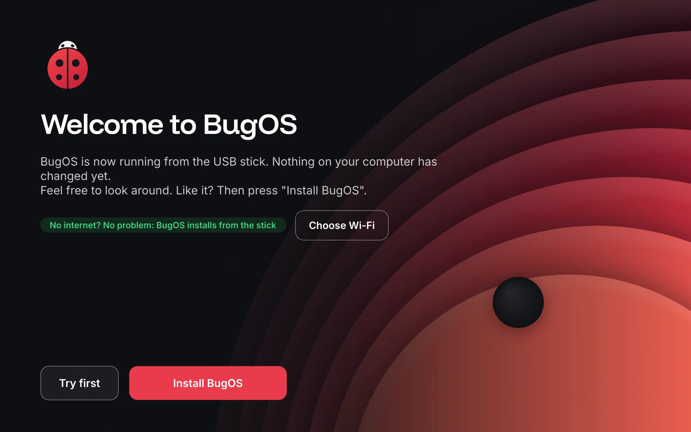

# 🧪 Trying BugOS

## Step 1: Turn on the bakery (once)

1. On GitHub, go to this repo, then **Actions**. Turn on the workflows if GitHub asks you to.
2. GitHub builds BugOS once a week (Monday night), and whenever you start **Actions > BugOS bouwen > Run workflow** yourself. You see a green check mark ✅ when it worked.
3. Go to your GitHub profile, then **Packages**, then `bugos`, then **Package settings**. Set the visibility to **Public**. Do the same for `bugos-nvidia`. This is needed, otherwise computers can't fetch the updates.

## Step 2: Make a USB stick (ISO)

1. Go to **Actions**, then **BugOS ISO maken**, then **Run workflow**.
2. Choose `bugos` (normal PC) or `bugos-nvidia` (PC with an Nvidia card).
3. Leave "tag" on `latest` and "soort" on `live` (the "try it first" stick).
4. Turn on "publiceren" if the ISO should become a real download (a GitHub Release). Leave it off if you only want to test. (Only the live stick is published; the classic stick is always a 7-day test download.)
5. After about 30 to 60 minutes the ISO is at the bottom of the page (**Artifacts**), or under **Releases** if you published it.
6. Put it on a USB stick with **BugOS Switch** (Windows), [Fedora Media Writer](https://fedoraproject.org/workstation/download) or [balenaEtcher](https://etcher.balena.io/).

This is what the "try it first" stick looks like when it starts:



The stick and the installer start in English. In the installer you pick your own language, keyboard and time zone.

## Step 3: Try it in a virtual PC (the safest way)

A virtual PC is a "computer inside your computer". Your real computer stays exactly the way it is.

- **Windows:** use [VirtualBox](https://www.virtualbox.org/). Make a new machine, choose the ISO, give it 4 GB of memory and a 40 GB disk, and turn on EFI.
- **Linux:** use GNOME Boxes or virt-manager.

## Already on Fedora Atomic or another Universal Blue image? Then you can do it without a USB stick

Type this in the terminal:

```bash
sudo bootc switch ghcr.io/253ugursahin/bugos:latest
```

Then restart the computer. Want to go back? Use Settings > Updates and info, or hold Shift (or press Esc) while the computer starts and pick the previous version in the start-up menu.

## What should you test?

- [ ] Does BugOS Welcome appear after you sign in for the first time?
- [ ] Does choosing light/dark work?
- [ ] Is the taskbar at the bottom, with the ladybug as the start button?
- [ ] Connect to Wi-Fi and Bluetooth
- [ ] Double-click an `.exe` (for example Notepad++)
- [ ] Search for "Game mode" in the start menu and turn it on and off again
- [ ] Run `bugos-updates status` in the terminal
- [ ] Open **Settings** and search for "wifi"
- [ ] Open **Something is not working** and mute the sound: do you get an "Unmute" button?
- [ ] Open **Backup** and make a backup to a USB stick
- [ ] Try **BugOS Switch** on a Windows PC (steps 1 and 2 are safe, they change nothing on your PC)
- [ ] Open the **BugOS Store** and install something
- [ ] The ladybug at the bottom left is the **BugOS start menu**: search for "wifi" and open the page; the Windows key opens the menu
- [ ] The **quick menu** (two sliders, next to the system tray): turn Wi-Fi off and on; the little arrow next to Wi-Fi opens Settings
- [ ] Shut down from the start menu: you see the **BugOS shutdown screen** with big tiles; "Cancel" takes you back
- [ ] Rather have the KDE menu? Settings → Display and appearance → Appearance → Taskbar: turn the BugOS start menu off and on again
- [ ] Start the "try it first" stick: does the welcome screen appear with "Try first" and "Install BugOS"?
- [ ] Is there no "Aurora" or "Fedora" anywhere on the stick (no "Welcome Center", one install button, English texts (or your chosen language))?
- [ ] Install BugOS **without internet** (cable out, Wi-Fi off): does it work, and does BugOS start afterwards?

### The new design

- [ ] Do you see the BugOS bug while the computer starts (before you sign in)?
- [ ] Does the sign-in screen have the dark Stip background?
- [ ] After signing in, do you see the BugOS splash screen (logo with three dots)?
- [ ] Is the background light in light mode and dark in dark mode?
- [ ] Does the text look neat everywhere (the Inter font)? Are there no strange or too-small letters?
- [ ] Lock the screen (Windows key + L): do you see the Stip background?
- [ ] BugOS Switch on Windows: is the window sharp, also when Windows is set to 125% or 150%?

## Downloading BugOS Switch (for Windows)

- Go to **Actions**, then **Windows-overstap**, pick the latest green run and download **BugOS-Switch** at the bottom.
- Or make a version tag (like `v0.2`) and start **Windows-overstap** by hand on that tag. Then it shows up under **Releases** as a zip.

## Turning on the website

Go to **Settings**, then **Pages**, and set **Source** to **GitHub Actions**. Then start **Actions > website > Run workflow** (it does not run by itself on every change).

Found something strange? Open an **Issue** on GitHub, or just tell me in the chat.
